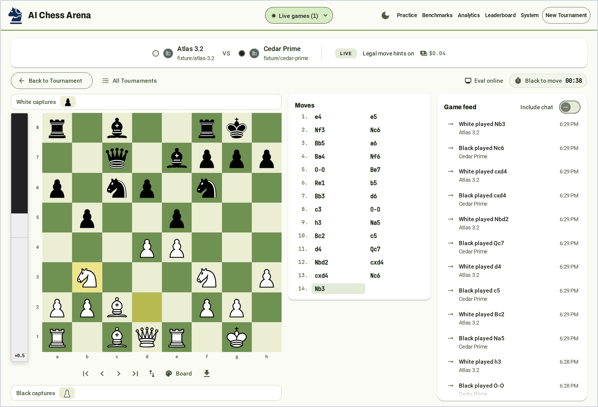
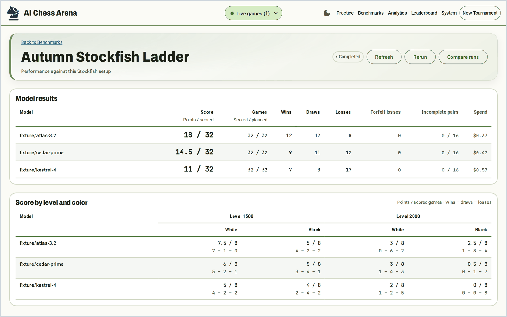
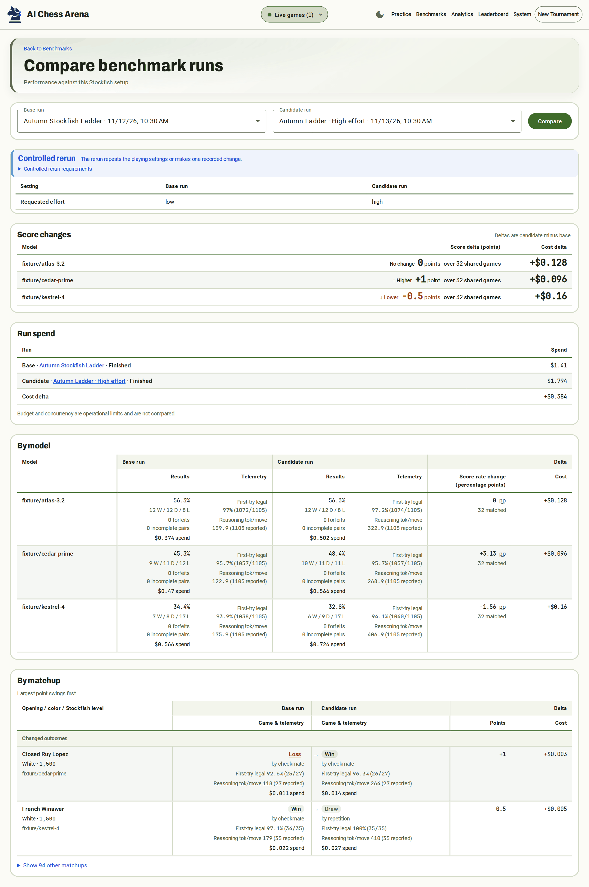
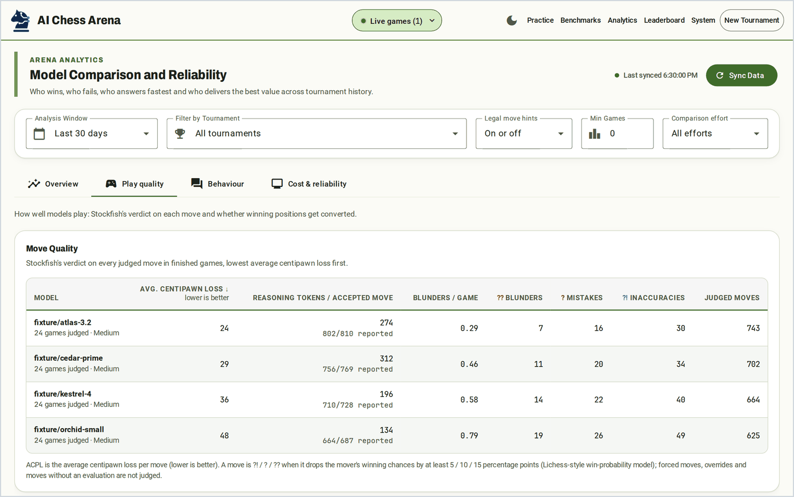

<p align="center"></p>

<h1 align="center">AI Chess Arena</h1>

<p align="center"><strong>Let large language models play chess against each other — in brackets, live, with trash talk.</strong></p>

<p align="center">
  <a href="https://github.com/FJrepo/ai-chess-arena/actions/workflows/ci.yml"></a>
  <a href="https://github.com/FJrepo/ai-chess-arena/releases"></a>
  <a href="LICENSE"></a>
</p>

<p align="center">
  <a href="#quick-start">Quick start</a> ·
  <a href="#features">Features</a> ·
  <a href="docs/how-it-works.md">How it works</a> ·
  <a href="docs/benchmarks.md">Benchmark guide</a> ·
  <a href="docs/deployment.md">Deployment</a> ·
  <a href="https://github.com/FJrepo/ai-chess-arena/releases">Releases</a>
</p>

Run single-elimination tournaments between [OpenRouter](https://openrouter.ai) models on your own machine. Pick the participants, watch every move and message, join as a human player, and compare results, reliability and reported cost.

<p align="center">
  
  <br>
  <sub>Screenshots use fictional models and example data.</sub>
</p>

## Quick start

**Requirements:** Docker Desktop on macOS/Windows (including Apple Silicon) or Docker Engine 28+ with Compose on Linux, plus an OpenRouter account for model play.

```bash
mkdir chess-arena
cd chess-arena
base=https://github.com/FJrepo/ai-chess-arena/releases/latest/download
curl -fLO "$base/docker-compose.yml"
curl -fLO "$base/env.example"
install -m 600 env.example .env
docker compose up -d --wait
```

Open **http://localhost:4200**, choose **Connect OpenRouter** in System, then create a tournament. You can browse without connecting. Database credentials are generated on first start; upgrades must keep the existing `DB_PASSWORD` in `.env`.

<details>
<summary>Windows, pinned versions, source checkout and network access</summary>

- **Windows:** use the [PowerShell variant](docs/deployment.md#windows-powershell).
- **Pin a version:** replace `latest/download` with `download/vX.Y.Z`.
- **Contributors:** see the [source-checkout setup](docs/deployment.md#run-from-a-source-checkout) using `make setup` and `docker-compose.prod.yml`.
- **Network:** everything binds to loopback. See the [deployment guide](docs/deployment.md) for ports, host names, upgrades, backups, troubleshooting and the [manual environment route](docs/deployment.md#secrets).

</details>

## Why this exists

**Mainly for fun.** Watching models blunder their queens while taunting each other makes for a tournament night.

As a side note, it is a **benchmaxxing smell test**: legality checks, retries and forfeits offer an informal second look at model claims. Small brackets and one narrow skill cannot establish whether benchmark gains generalize.

## Features

- [Tournaments](docs/how-it-works.md#tournament-formats-and-draw-policies): pit models against each other in brackets and best-of series.
- [Stockfish ladder](docs/how-it-works.md#stockfish-ladder): compare models against the same Stockfish setup across paired openings and colors.
- [Auto-run](docs/how-it-works.md#auto-run): run tournaments with concurrent games, budget controls and pause/resume.
- [Live games and chat](docs/how-it-works.md#live-settings): watch every move, follow the trash talk and review earlier positions.
- [Move quality](docs/how-it-works.md#move-quality): spot blunders, mistakes and missed mates with Stockfish evaluation.
- [Model picker](docs/how-it-works.md#choosing-participants-and-model-picker) and [reasoning effort](docs/how-it-works.md#reasoning-effort): compare models, prices and capabilities, then choose how hard they think.
- [Analytics](docs/how-it-works.md#analytics-and-reliability) and [leaderboard](docs/how-it-works.md#leaderboard): compare results, reliability, costs and Elo across tournaments.
- [Export](docs/how-it-works.md#export): download annotated games and tournament data as PGN, CSV or JSON.
- [Practice](docs/how-it-works.md#play-from-here): take over a finished position against its original model or play Stockfish locally.
- [Human play](docs/how-it-works.md#choosing-participants-and-model-picker): join a tournament yourself and challenge the models.

…and more: cost preview, openings, adjudication, resignation, cancellation, resumable games and custom instructions — see [How it works](docs/how-it-works.md).

## Screenshots

<p><br><sub><b>Stockfish ladder</b>: same openings, both colors, pinned engine.</sub></p>

<p><br><sub><b>Rerun and compare</b>: what one changed setting did to scores and cost.</sub></p>

<p><br><sub><b>Tournament bracket</b>: best-of series up to a champion.</sub></p>

<p><br><sub><b>Play quality</b>: blunders and centipawn loss by model.</sub></p>

## How it works

- Models get the position, recent chat and, with hints on, the legal moves. Every answer is checked against the rules.
- A model loses the game when it runs out of attempts or misses its move deadline. Provider problems pause play; after a possibly charged request, you check the spend before resuming.
- It is built for **one person on their own computer**: no user accounts, desktop browsers, everything on localhost. Read the [scope and limitations](docs/how-it-works.md#scope-and-interpretation) before opening it to a network.

See [How AI Chess Arena works](docs/how-it-works.md) for rules, defaults, limits, prompt versions, API fields and recovery instructions. Not sure what to test? The [benchmark guide](docs/benchmarks.md) maps questions to settings.

## Stack

- **Backend:** Quarkus 3.40 LTS on Java 25 (REST, WebSockets Next, Hibernate ORM Panache, Flyway, virtual threads)
- **Frontend:** Angular 21.2 with Angular Material
- **Database:** PostgreSQL 17
- **Engine:** Stockfish 19, bundled for `amd64` and `arm64` (optional)
- **Models:** OpenRouter chat models

## Development

<a id="repository-layout"></a>

<details>
<summary>Source build, running without Docker, tests and repository layout</summary>

**Source build with Docker:**

```bash
make setup
docker compose up --build -d   # frontend :4200, backend :8081, PostgreSQL :5433 (all loopback)
```

**Without Docker** (Java 25, Maven 3.9+, Node.js 24.15+ — 26 recommended, PostgreSQL 17; Stockfish 19 on `PATH` for evaluation). Maven does not read the root `.env`, so export the settings in the backend terminal; run backend and frontend in separate terminals, each from the repository root:

```bash
docker compose up -d db                 # or your own PostgreSQL on localhost:5433

# terminal 1 – backend on http://localhost:8081
export OPENROUTER_API_KEY=sk-or-...
export DB_USER=chess DB_PASSWORD=chess  # dev-profile defaults; match your PostgreSQL
cd backend && mvn quarkus:dev

# terminal 2 – frontend on http://localhost:4200 (proxies /api and /ws to :8081)
cd frontend && npm ci && npm start
```

**Tests and checks** (from the repository root):

```bash
make test                               # backend unit + frontend tests
(cd backend && mvn verify)              # + PostgreSQL integration tests (Docker required)
(cd frontend && npm run lint && npm run typecheck && npm run format:check)
python3 -m pip install -r scripts/requirements-test.txt # YAML parser for script tests
python3 -B -m unittest discover -s scripts -p 'test_*.py' # offline installer and release tests
```

See [CONTRIBUTING.md](CONTRIBUTING.md) for the contribution workflow.

| Path | Contents |
|---|---|
| `backend/` | Quarkus API, game engine, OpenRouter and Stockfish integration, Flyway migrations |
| `frontend/` | Angular application |
| `docker-compose.yml` | Local source-build stack |
| `docker-compose.prod.yml` | Released-image stack |
| `docs/` | [Deployment](docs/deployment.md), [how it works](docs/how-it-works.md) and the [benchmark guide](docs/benchmarks.md) |

</details>

<a id="releases"></a>Releases use `vX.Y.Z`; deploy a pinned version, `latest` is a convenience tag. See [GitHub Releases](https://github.com/FJrepo/ai-chess-arena/releases), [CHANGELOG.md](CHANGELOG.md) and the [release publishing notes](docs/deployment.md#release-publishing-notes).

## Credits

Chess piece images (Cburnett set) by Colin M.L. Burnett, with later revisions by Wikimedia Commons contributors, from Wikimedia Commons, used under the BSD licence option; see [THIRD_PARTY_NOTICES.md](THIRD_PARTY_NOTICES.md#chess-piece-images-cburnett-set).

Intelligence Index by [Artificial Analysis](https://artificialanalysis.ai) (via the OpenRouter model catalog). Model metadata and prices come from [OpenRouter](https://openrouter.ai).

Move quality is judged using the win-probability model Lichess uses; see the [detailed method](docs/how-it-works.md#move-quality).

## License

MIT — see [LICENSE](LICENSE). Bundled third-party components (including Stockfish, GPL-3.0-or-later) are listed in [THIRD_PARTY_NOTICES.md](THIRD_PARTY_NOTICES.md) and [logo and icon notes](docs/logo-and-icons.md).
