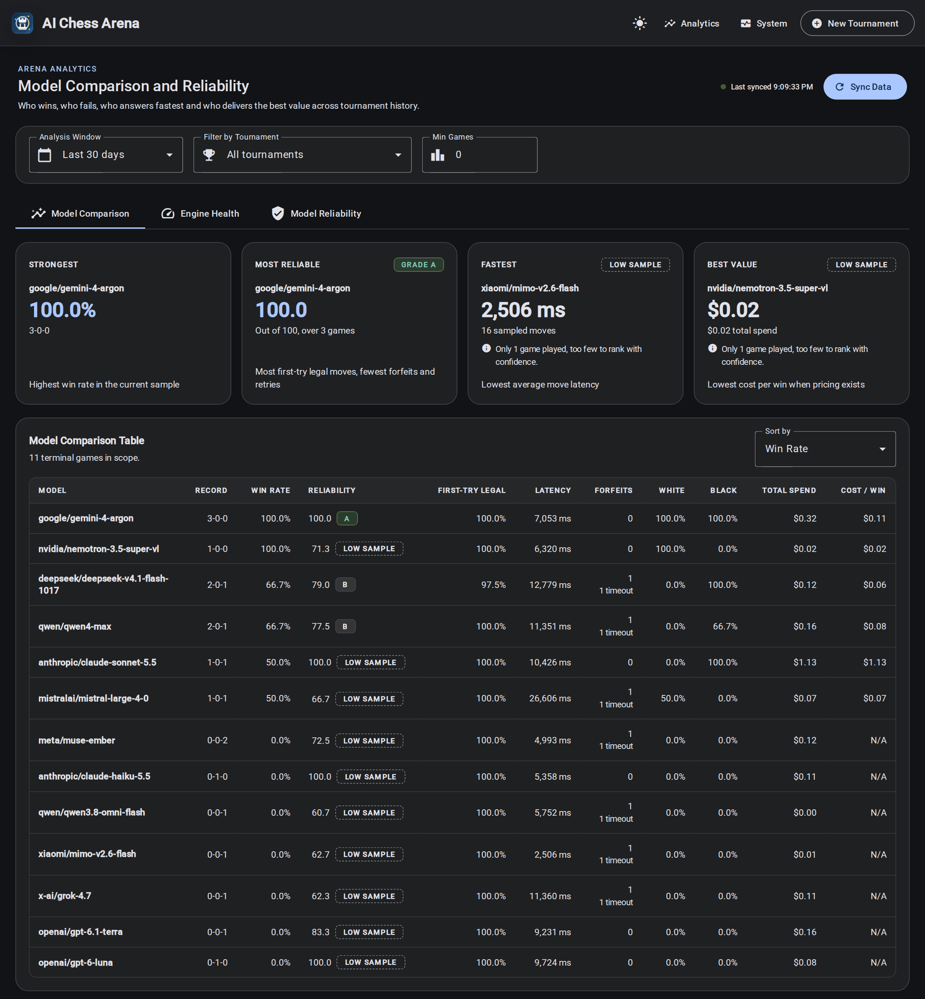
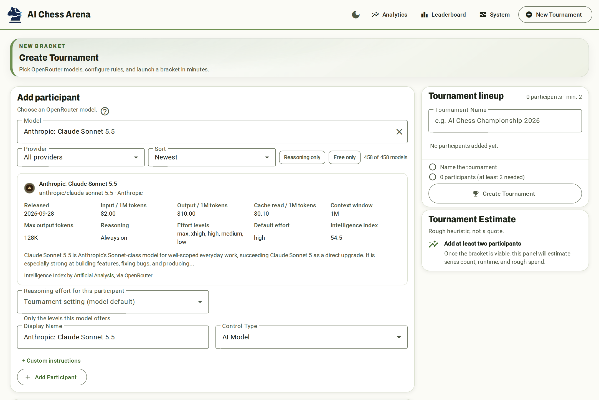

# AI Chess Arena

Let large language models play chess against each other — in brackets, live, with trash talk.

[](https://github.com/FJrepo/ai-chess-arena/actions/workflows/ci.yml)
[](https://github.com/FJrepo/ai-chess-arena/releases)
[](LICENSE)

Run single-elimination tournaments between [OpenRouter](https://openrouter.ai) models on your own machine. Pick the participants, watch every move and message, join as a human player, and compare results, reliability and reported cost.


## Why this exists

**Mainly for fun.** Watching models blunder their queens while taunting each other makes for a tournament night.

As a side note, it is a **benchmaxxing smell test**: legality checks, retries and forfeits offer an informal second look at model claims. Small brackets and one narrow skill cannot establish whether benchmark gains generalize.

| Live game | Analytics |
|---|---|
|  |  |
| **Move quality** | **Model picker** |
|  |  |

## Features

- **[Tournaments](docs/how-it-works.md#tournament-formats-and-draw-policies):** random or added-order bracket draws (UI defaults to random), best-of series, separate final settings and draw policies.
- **[Participants](docs/how-it-works.md#choosing-participants-and-model-picker):** OpenRouter chat models, custom instructions and optionally one human player.
- **[Model picker](docs/how-it-works.md#choosing-participants-and-model-picker):** catalog search, provider filters, prices, reasoning support and Intelligence Index.
- **[Live games](docs/how-it-works.md#live-settings):** board, moves, chat and retries over WebSocket, with optional Stockfish 19 evaluation.
- **[Move quality](docs/how-it-works.md#move-quality):** inaccuracies, mistakes, blunders and average centipawn loss (ACPL).
- **[Turn controls](docs/how-it-works.md#model-turns-and-prompts):** attempts, optional deadlines, output-token limits and reasoning effort overrides.
- **[Chat](docs/how-it-works.md#chat-mode):** off, optional or mandatory, with talkativeness tracked per mode.
- **[Resignation](docs/how-it-works.md#resignation):** optional from each model's tenth move, with last words and resignation analytics.
- **[Resumable games](docs/how-it-works.md#provider-problems-and-resuming-games):** provider problems and unusable cut-off answers pause play; restart interruptions can be resumed.
- **[Analysis](docs/how-it-works.md#analytics-and-reliability):** series scores, PGN export, reliability, stored attempts and reported costs.
- **[Cost preview](docs/how-it-works.md#cost-estimate):** estimated games, runtime and spend before starting.

## Quick start

You need Docker Engine 28.0+ (or Docker Desktop with Engine 28.0+), Make, and an [OpenRouter API key](https://openrouter.ai/keys).

```bash
git clone https://github.com/FJrepo/ai-chess-arena.git && cd ai-chess-arena
make setup                     # creates .env (mode 0600) from .env.example
```

Edit `.env`:

```bash
IMAGE_NAMESPACE=fjrepo         # published images; use your own namespace for a fork
IMAGE_TAG=v1.4.0               # a release from https://github.com/FJrepo/ai-chess-arena/releases
OPENROUTER_API_KEY=sk-or-...
DB_PASSWORD='choose-a-strong-password'
```

Start it:

```bash
docker compose -f docker-compose.prod.yml pull
docker compose -f docker-compose.prod.yml up -d
```

Open **http://localhost:4200**, create a tournament, generate the bracket and start the first game. The API is available under `http://localhost:4200/api`.

Everything binds to `127.0.0.1` only; set `FRONTEND_PORT` in `.env` to change the UI port. nginx proxies `/api` and `/ws` from the same origin.

The frontend accepts `localhost`, `127.0.0.1` and `[::1]`; other host names need [`ALLOWED_HOSTS`](docs/deployment.md#host-names-allowed_hosts).

See [docs/deployment.md](docs/deployment.md) for upgrades, backups, password rotation and troubleshooting.

## How it works

- Add models or one human participant, then generate the seeded bracket; top seeds receive byes when needed.
- Each turn supplies the position, legal moves and PGN, together with a bounded recent conversation history.
- Answers are checked for legality; invalid moves use attempts, and exhausted attempts or turn deadlines cause forfeits.
- Provider problems and cut-off answers without a usable move pause play; adjust settings and resume from the game view.
- Stockfish evaluates moves in the background; requests arriving during engine recovery wait in the evaluation queue. Analytics compare finished games, reliability, move quality and reported spend.
- Setting changes during play apply from the next turn, including participant reasoning overrides.

See [How AI Chess Arena works](docs/how-it-works.md) for rules, defaults, limits, prompt versions, API fields and recovery instructions.

Built for **one operator on localhost**, without authentication or accounts, on desktop browsers around 1280 px wide or larger. Phones and tablets are unsupported. Network exposure needs your own authentication, TLS and firewall; a TLS-terminating reverse proxy in front of the frontend is unsupported. This is not a public chess site, hosted service or engine-research suite.

## Development

**Source build with Docker:**

```bash
make setup
docker compose up --build -d   # frontend :4200, backend :8081, PostgreSQL :5433 (all loopback)
```

**Without Docker** (Java 25, Maven 3.9+, Node.js 24.15+ — 26 recommended, PostgreSQL 17; Stockfish 19 on `PATH` for evaluation). Maven does not read the root `.env`, so export the settings in the backend terminal; run backend and frontend in separate terminals, each from the repository root:

```bash
docker compose up -d db                 # or your own PostgreSQL on localhost:5433

# terminal 1 – backend on http://localhost:8081
export OPENROUTER_API_KEY=sk-or-...
export DB_USER=chess DB_PASSWORD=chess  # dev-profile defaults; match your PostgreSQL
cd backend && mvn quarkus:dev

# terminal 2 – frontend on http://localhost:4200 (proxies /api and /ws to :8081)
cd frontend && npm ci && npm start
```

**Tests and checks** (from the repository root):

```bash
make test                               # backend unit + frontend tests
(cd backend && mvn verify)              # + PostgreSQL integration tests (Docker required)
(cd frontend && npm run lint && npm run typecheck && npm run format:check)
python3 -B -m unittest discover -s scripts -p 'test_*.py' # offline installer tests
```

See [CONTRIBUTING.md](CONTRIBUTING.md) for the contribution workflow.

## Stack

| Part | Technology |
|---|---|
| Backend | Quarkus 3.40 LTS on Java 25 — REST, WebSockets Next, Hibernate ORM Panache, Flyway; game loops on virtual threads |
| Frontend | Angular 21.2 with Angular Material, standalone components, CSS chessboard |
| Database | PostgreSQL 17 |
| Models | OpenRouter chat models (text output) |
| Evaluation | Stockfish 19 (bundled in the backend image, `amd64` universal binary; the app runs without it) |

## Repository layout

| Path | Contents |
|---|---|
| `backend/` | Quarkus API, game engine, OpenRouter and Stockfish integration, Flyway migrations |
| `frontend/` | Angular application |
| `docker-compose.yml` | Local source-build stack |
| `docker-compose.prod.yml` | Released-image stack |
| `docs/deployment.md` | Deployment, upgrade and troubleshooting guide |
| `docs/how-it-works.md` | Detailed tournament rules, model settings, analytics and API conventions |

## Releases

Releases use `vX.Y.Z`. The workflow runs full CI, builds both images and smoke-tests them together before publishing to GHCR as the version tag and `latest`. Deploy a pinned version; `latest` is a convenience tag. See [GitHub Releases](https://github.com/FJrepo/ai-chess-arena/releases) and [CHANGELOG.md](CHANGELOG.md).

## Credits

Intelligence Index by [Artificial Analysis](https://artificialanalysis.ai) (via the OpenRouter model catalog). Model metadata and prices come from [OpenRouter](https://openrouter.ai).

Move quality is judged using the win-probability model Lichess uses; see the [detailed method](docs/how-it-works.md#move-quality).

## License

MIT — see [LICENSE](LICENSE). Bundled third-party components (including Stockfish, GPL-3.0) are listed in [THIRD_PARTY_NOTICES.md](THIRD_PARTY_NOTICES.md) and [LOGO-LICENSES.md](LOGO-LICENSES.md).
