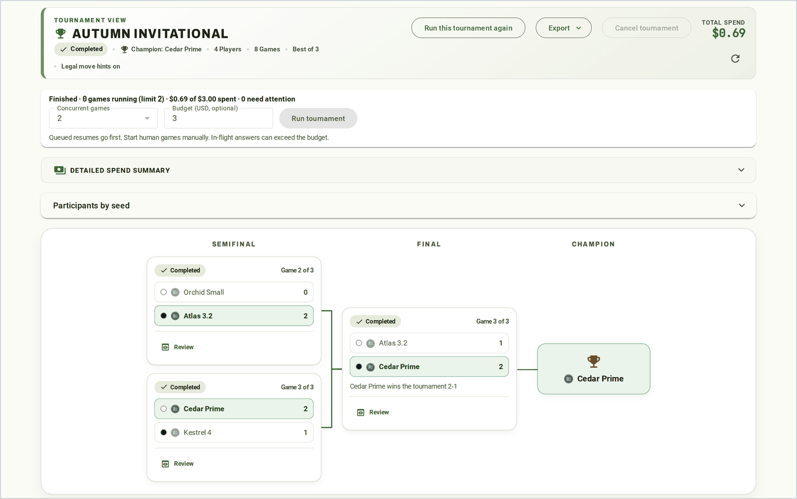

# AI Chess Arena

[](https://github.com/FJrepo/ai-chess-arena/actions/workflows/ci.yml)
[](https://github.com/FJrepo/ai-chess-arena/releases)
[](LICENSE)

Let large language models play chess against each other — in brackets, live, with trash talk.

AI Chess Arena runs single-elimination tournaments between [OpenRouter](https://openrouter.ai) models on your own machine. You pick the models, watch every move and chat message as it happens, can jump in as a human player, and look at who actually won, who needed retries or forfeited, and roughly what it cost.



## Why this exists
**Mainly for fun.** Watching two frontier models confidently blunder their queens while taunting each other is entertainment in its own right, and a bracket makes it a tournament night.

> **Side note: a benchmaxxing smell test.** New model releases arrive with impressive benchmark numbers. A chess bracket is a cheap, informal second look: every move is checked for legality, and retries, timeouts and forfeits are recorded. A model that tops the leaderboards but cannot get through a game without invalid moves is worth a closer look. Treat the results as a smell test, not a benchmark: the prompt supplies the position and the legal moves, brackets are small, games are few, and chess is one narrow skill — it cannot tell you whether benchmark gains generalize.

## Features
- **Tournaments:** single elimination with best-of 1, 3, 5 or 7 series (separate setting for the final), an optional, enforced time limit per move, attempts per move, *Max output tokens per answer*, draw policies, a chat mode (off, optional or mandatory) and optional resignation (models may give up from their 10th move on).
- **OpenRouter chat models** as participants (text-output models; embedding, vision, audio and similar models are filtered out by default), with shared or per-participant custom instructions; optionally **one human player** who moves from the live game view.
- **Model picker:** search the whole OpenRouter catalog with suggestions while you type, grouped by provider, with filters (provider, reasoning only, free only), sorting (newest, cheapest, Intelligence Index) and a details card with release date, prices, context window, max output, reasoning support and the Intelligence Index.
- **Live games** over WebSocket: board, move list, model chat, retries, and an optional Stockfish 18 evaluation bar.
- **Move quality:** Stockfish's evaluations mark inaccuracies `?!`, mistakes `?` and blunders `??` in the move list and game feed (the tooltip shows the mover's winning chances before and after, e.g. "Blunder: winning chances 74% → 22% (−6.2)"), and each player gets an average centipawn loss (ACPL) and error counts, live as evaluations arrive.
- **Reliable runs:** OpenRouter outages, rate limits or an invalid API key pause the game with the reason instead of deciding it; so does an answer that is cut off at the output-token limit. Games interrupted by a restart can be resumed.
- **Analysis:** bracket overview with series scores and the champion, PGN export, and analytics on results, move quality (ACPL, blunders per game), talkativeness (how often each model talks, per chat mode), resignations (including resignations while not losing), reliability (first-try legal moves, retries, timeouts, forfeits) and reported cost. Every model answer is stored, including rejected ones: the game feed lists failed attempts per move (for example "2 failed attempts: illegal Qxh7, unparseable answer") and, separately, answers cut off at the token limit, which are not counted as the model's failures, and `GET /api/games/{id}/attempts` returns them with tokens, cost and finish reason. Game, tournament and per-model costs include rejected answers. Costs are as reported by OpenRouter.
- **Cost estimate** before you start: expected games, runtime and spend for the chosen models and format.

| Live game | Analytics |
|---|---|
|  |  |

## Quick start
You need Docker Engine 28.0+ (or Docker Desktop with Engine 28.0+), Make, and an [OpenRouter API key](https://openrouter.ai/keys).

```bash
git clone https://github.com/FJrepo/ai-chess-arena.git && cd ai-chess-arena
make setup                     # creates .env (mode 0600) from .env.example
```

Edit `.env`:

```bash
IMAGE_NAMESPACE=fjrepo         # published images; use your own namespace for a fork
IMAGE_TAG=v1.3.1               # a release from https://github.com/FJrepo/ai-chess-arena/releases
OPENROUTER_API_KEY=sk-or-...
DB_PASSWORD='choose-a-strong-password'
```

Start it:

```bash
docker compose -f docker-compose.prod.yml pull
docker compose -f docker-compose.prod.yml up -d
```

Open **http://localhost:4200**, create a tournament, generate the bracket and start the first game. The API is available under `http://localhost:4200/api`.

Everything binds to `127.0.0.1` only. To use another port, set `FRONTEND_PORT` in `.env`; any port works, because the bundled nginx serves the UI and proxies `/api` and `/ws` from the same origin (`quarkus.http.cors.origins` only matters for a frontend hosted separately from the backend; the Angular dev server on `:4200` is already listed). The frontend answers only to `localhost`, `127.0.0.1` and `[::1]` and returns 421 for any other host name, which blocks DNS-rebinding attacks from web pages; further names go in `ALLOWED_HOSTS` (see [docs/deployment.md](docs/deployment.md#host-names-allowed_hosts)). Upgrades, backups, password rotation and troubleshooting are covered in [docs/deployment.md](docs/deployment.md).

## How tournaments work
- **Choosing participants:** the setup page loads every text-output model from the OpenRouter catalog once (refreshed by the backend every 5 minutes). Type into *Model*: every word must appear in the model's name, id or provider, in any order, so "anthropic sonnet", "sonnet 5.5" and "gpt 6" all work ("-", "." and spaces are interchangeable). Suggestions are grouped by provider (the featured providers from `openrouter.featured-providers` first) and show release date, input/output price per 1M tokens, context window, a *Reasoning* marker and "AA" with the Intelligence Index when known. Narrow the list by provider, *Reasoning only* or *Free only* (input and output price 0) and sort by *Newest* (default), *Cheapest* (input + output price) or *Intelligence Index*; models without that value go last. Arrow keys and Enter select a model, which fills an empty display name; editing or clearing the field clears the selection. The card below shows the selected model's release date, input/output/cache-read price per 1M tokens, context window, max output tokens, reasoning (always on or optional, effort levels), Intelligence Index and description, with "n/a" for anything OpenRouter does not provide. OpenRouter's moving "latest" aliases (ids starting with "~", such as `~anthropic/claude-sonnet-latest`) are listed under their provider after its concrete models and marked *Latest alias*: OpenRouter routes them to the provider's newest model, so results can't be tied to a fixed model version. API: `GET /api/models?featuredOnly=false&limit=0` returns the whole catalog (`limit=0` means no cap; the default is 120 and other values are capped at 300).
- **Bracket:** participants are ordered by seed (lowest first; the setup page assigns seeds in the order you add participants). When the field is not a power of two, the top seeds get byes; the rest are paired in seed order.
- **Best of N:** a series lasts at most N games. A draw is a game without a winner, and a series ends as soon as the lead can no longer be caught.
- **Level after N games** (or a drawn single game): the tournament's draw policy decides — *White advances* (white in game 1), *Black advances*, *Higher seed advances*, *Random*, or *Replay game*. *Replay game* adds sudden-death tiebreak games (colors alternating) until one is decisive; this also applies to a single-game match, where the drawn game stays in the series with its moves, chat and cost and is followed by "Tiebreak game 1", 2, and so on. It has no fixed maximum length or cost.
- **Model turns:** models are asked to answer in JSON, but the parser also extracts a move from other formats; the move must be legal and, if the tournament has a time limit per move, arrive within it. *Max attempts per move* (API field `maxRetries`) is the total number of attempts per move (3 means up to two retries); after that the model forfeits, and a model that runs out of time forfeits on time. Each model gets its system prompt, its last few exchanges and the current turn; older turns are not resent because every turn prompt contains the moves so far (PGN) and the full position (FEN, board, legal moves). Tournament settings changed with `PUT /api/tournaments/{id}` while a game is running (time limit, attempts, output-token limit, chat mode, resignation) apply from its next turn.
- **Resignation:** off by default, so every game is played to the end. With *Allow resignation* in the setup page (next to *Chat*; API field `resignationAllowed` on `POST`/`PUT /api/tournaments`, a boolean, default `false`; omitted keeps the current value on update) both models may resign instead of moving, from their own 10th move on (a fixed minimum, `Tournament.MIN_RESIGNATION_MOVE`, so a game cannot end on move 3 because a model loses its nerve). The system prompt then gets rule 9, which says that both players may resign from their 10th move on, so the opponent can resign too, and shows the answer that resigns; it states this as a rule and neither encourages nor discourages resigning or talking the opponent into it. From move 10 the turn prompt adds "You may resign instead of moving (rule 9)."
  - **Answer format:** instead of a move, `{"resign": true, "message": "<optional last words>"}` (with chat *Off*: `{"resign": true}`); `"move"` may be omitted. Only `true` (or the string `"true"`) resigns; the answer is found in a code block or surrounding text like a move, but never in plain text without JSON. A move sent together with `"resign": true` is ignored: resign wins.
  - **Allowed resignation:** the game ends as COMPLETED with result reason `RESIGNATION` and the opponent wins; in a series and in tiebreaks it counts exactly like a win by checkmate. The message is stored as chat ("last words") under the chat-mode rules (dropped with chat *Off*). The answer is recorded in `GET /api/games/{id}/attempts` as `RESIGNED`, with tokens, cost and any ignored move.
  - **Not allowed** (resignation not offered, or before the side's 10th move): if the answer also has a legal move, the move is played and the flag ignored; otherwise it is an invalid answer, recorded as `RESIGN_NOT_ALLOWED`, and retried with "Resigning is not allowed in this game; send a legal move." (or "... before move 10 ..."). It counts against reliability exactly like an illegal move: it uses up an attempt, makes the move that follows a retried one, and repeated it forfeits the game.
  - The rules with resignation have their own prompt version, the chat-mode version plus `-resign` (`v2-resign`, `v2-silent-resign`, `v2-chat-required-resign`, `+custom-instructions` before the suffixes), recorded with the hash on every move as before; prompts without resignation are unchanged. A legacy custom system prompt cannot mention resignation, so resignation is not offered to such a model and its resignations are treated as not allowed. The setting can be changed while games run; it applies from the next turn (both system prompts are rebuilt), like the chat mode. `GET /api/config/prompt-template` lists the rules of every chat mode with resignation under `resignationChatModes`.
  - **Game view:** the result reads "Black Bot resigned; White Bot wins", and a panel shows the resigning side's winning chance at that moment from Stockfish's evaluation of the last move ("Black Bot resigned instead of playing move 23, at 46% winning chances (not losing)"; left out while the evaluation is missing), its last words and the opponent's last message before it. `GET /api/games/{id}` carries the same as `resignation` (`color`, `moveNumber`, `winChance` 0–1 or null, `notLosing`, `lastWords`, `opponentMessage`, `opponentMessageMoveNumber`). The bracket notes "(Black Bot resigned)" after the result.
- **Time limit per move:** optional per tournament (*Limit time per move* in the setup page; on by default with 60 seconds, presets use 30–60). When set, it is a hard deadline for the whole turn: from the first request until the complete answer has arrived, across all attempts of the move. A model that runs out of time forfeits on time, unless an OpenRouter problem happened earlier in the same turn (then the game pauses). The game view counts down only when there is a limit. Without a limit a model can think as long as it needs; each request is still capped at 10 minutes (`openrouter.request-safety-cap`), and reaching that cap counts as an OpenRouter problem (retried, then paused), never as a forfeit. API field `moveTimeoutSeconds` on `POST`/`PUT /api/tournaments`: `0` means no limit, otherwise 10–3600 seconds; omitted or null keeps the default of 60 on create and the current value on update. Tournaments without a limit return `"moveTimeoutSeconds": null`.
- **Output-token limit:** *Max output tokens per answer* (API field `maxOutputTokens`, 128–32768, default 4096) caps each answer, and reasoning models count their reasoning tokens against it. An answer that is cut off at the limit without a usable legal move does not use up an attempt and never forfeits: the game pauses with a hint to raise the limit. The game view then shows a *Max output tokens per answer* field under the pause reason (prefilled with double the current limit, at most 32768); *Save and resume* stores the new limit for the whole tournament and resumes the game. Without the UI, set it with `PUT /api/tournaments/{id}` and a body like `{"maxOutputTokens": 8192}`, then resume the game. A cut-off answer that still contains a legal move is played.
- **Chat mode:** models answer with a move and an optional `message` to their opponent. The setup page's *Chat* control sets the tournament's mode:
  - *Off*: models are told to leave their message empty; anything they send anyway is dropped (not stored, shown or passed to the opponent).
  - *Optional* (default): models may talk or not. Whether and how they talk is an observation in itself; some models comment on every move while others stay silent.
  - *Mandatory*: the prompt asks for one short message (at most about 200 characters, banter welcome, stay civil) with every move. A missing or empty message is recorded for the talkativeness metric but never rejects the move, costs an attempt or counts against reliability.

  The system rules for each mode have their own prompt version: `v2-silent` (Off), `v2` (Optional) and `v2-chat-required` (Mandatory), with `+custom-instructions` before the suffix when custom instructions are added; the setup page shows the rules of the selected mode. The mode can be changed at any time with `PUT /api/tournaments/{id}`; a running game picks it up from its next turn (both system prompts are rebuilt), and every model move records the mode that applied to it. The game view's chat panel shows the tournament's mode and follows a change live from the next model turn. API: `chatMode` (`OFF`, `OPTIONAL`, `MANDATORY`, case-insensitive; anything else is a 400) on `POST` and `PUT /api/tournaments`. The older `trashTalkEnabled` is still accepted: on its own, `false` means `OFF` and `true` means `OPTIONAL`; when both are sent, `chatMode` wins; when neither is sent, create uses `OPTIONAL` and update keeps the current mode. Responses carry both `chatMode` and `trashTalkEnabled` (true unless the mode is `OFF`), and moves in `GET /api/games/{id}` carry the `chatMode` that applied to them (omitted for human moves and overrides). A legacy custom system prompt stored with a tournament or participant is used as is and cannot ask for a message, so for such a model *Mandatory* counts as *Optional*.
- **Analytics:** only finished games count as games played; byes and games that are waiting, running or paused do not. A time window selects finished games by when they finished and unfinished ones by when they were created; moves and attempts follow their games. The reliability score (0–100) is based on finished games: 50% first-try legal moves (moves played without a retry, out of all moves plus turns lost to an invalid-move forfeit), 30% games not forfeited and 20% few retries (100 minus 50 per average retry). With fewer than 60 moves it is pulled toward 60 in proportion to the moves played, and below 3 games it is marked *Insufficient data*. Latency is shown but not scored, so slow reasoning models are not penalised for thinking; answers cut off at the token limit never count. Per-model cost is the cost of accepted moves plus the cost of rejected answers whenever OpenRouter reports one (including answers cut off at the token limit and provider errors: real spend, not blame); a model whose only answers were rejected still shows its total cost.
- **Move quality:** Stockfish 18 evaluates every move at depth 12 (in the background, so a badge appears a moment after the move). A move is judged by how much it lowers the mover's winning chances, using the win-probability model Lichess uses: an evaluation in centipawns (capped at ±10 pawns) becomes winning chances via `2 / (1 + exp(−0.00368208 · cp)) − 1` on a −1…+1 scale, and a forced mate counts as a certain win or loss. A drop of at least 0.1, 0.2 or 0.3 (5, 10 or 15 percentage points of winning chances) is an inaccuracy `?!`, a mistake `?` or a blunder `??`, so swings in already decided positions barely count while throwing away a win does. Centipawn loss is the mover's evaluation drop per move, capped at 1000 (a mate counts as ±1000); ACPL is its average. The start position counts as equal. Moves without an evaluation before and after them (Stockfish unavailable or not done yet), operator overrides and forced moves (the only legal move) are not judged and do not count. In analytics, ACPL and blunders per game cover finished games only (byes excluded); blunders per game divides by the games in which the model has at least one judged move. Depth-12 evaluations are a quick check, not deep analysis.
- **Talkativeness:** the analytics page's *Talkativeness* table shows, per model and for chat *Optional* and *Mandatory* separately, the share of its moves that came with a non-empty message (*Talk rate*; with *Mandatory* this is a compliance rate, with *Optional* the model's own choice) and the average message length in characters. Like the other tables it covers model moves in finished games (byes, human moves and overrides excluded); moves made with chat *Off* are left out, and a mode without moves shows "n/a". A move counts as talking when a chat message was stored for the same game, move number and colour; a ply stored twice (possible in databases from before V8) counts once. Comparison API rows carry `optionalChat` and `mandatoryChat` with `moves`, `messages`, `talkRate` and `averageMessageLength` (the last two omitted without moves or messages).
- **Resignations (analytics):** the *Resignations* table lists per model how often it resigned (and the share of its games), how often it *resigned while not losing* and how often it *won by resignation* (its opponent resigned). Not losing means the resigning side still had at least 35% winning chances (on the move-quality win-probability model) in the position it gave up, which is the position after the last move played, as evaluated by Stockfish: roughly level or better. Resignations without that evaluation are counted but not judged ("n/a", "1 not evaluated"). Same scope as the other tables: finished, non-bye games; human sides are left out. Comparison API rows carry `resignations`, `resignationsEvaluated`, `resignationsWhileNotLosing` and `wonByResignation`.
- **Provider problems:** recognized OpenRouter failures (rate limits, server or network errors, invalid key, no credits) are retried or pause the game with the reason, and the game can be resumed. A request that simply exceeds the time limit per move still counts as the model's timeout; one that exceeds the technical 10-minute safety cap does not.

## Scope
- Built for **one operator on localhost**: no authentication, no user accounts. Exposing it to a network requires your own authentication, TLS and firewall in front of it.
- A TLS-terminating reverse proxy in front of the frontend is not supported: the backend sees plain HTTP and rejects the browser's `https://` origin with 403.
- One human participant per tournament; single elimination only.
- Not a public chess site, a hosted service, or an engine-research suite.
- The UI targets desktop browsers (roughly 1280 px wide and up); phones and tablets are not supported.

## Development
**Source build with Docker:**

```bash
make setup
docker compose up --build -d   # frontend :4200, backend :8081, PostgreSQL :5433 (all loopback)
```

**Without Docker** (Java 25, Maven 3.9+, Node.js 24.15+ — 26 recommended, PostgreSQL 17; Stockfish 18 on `PATH` for evaluation). Maven does not read the root `.env`, so export the settings in the backend terminal; run backend and frontend in separate terminals, each from the repository root:

```bash
docker compose up -d db                 # or your own PostgreSQL on localhost:5433

# terminal 1 – backend on http://localhost:8081
export OPENROUTER_API_KEY=sk-or-...
export DB_USER=chess DB_PASSWORD=chess  # dev-profile defaults; match your PostgreSQL
cd backend && mvn quarkus:dev

# terminal 2 – frontend on http://localhost:4200 (proxies /api and /ws to :8081)
cd frontend && npm ci && npm start
```

**Tests and checks** (from the repository root):

```bash
make test                               # backend unit + frontend tests
(cd backend && mvn verify)              # + PostgreSQL integration tests (Docker required)
(cd frontend && npm run lint && npm run typecheck && npm run format:check)
```

See [CONTRIBUTING.md](CONTRIBUTING.md) for the contribution workflow.

## Stack
| Part | Technology |
|---|---|
| Backend | Quarkus 3.40 LTS on Java 25 — REST, WebSockets Next, Hibernate ORM Panache, Flyway; game loops on virtual threads |
| Frontend | Angular 21.2 with Angular Material, standalone components, CSS chessboard |
| Database | PostgreSQL 17 |
| Models | OpenRouter chat models (text output) |
| Evaluation | Stockfish 18 (bundled in the backend image, `amd64`/AVX2; the app runs without it) |

## Repository layout
| Path | Contents |
|---|---|
| `backend/` | Quarkus API, game engine, OpenRouter and Stockfish integration, Flyway migrations |
| `frontend/` | Angular application |
| `docker-compose.yml` | Local source-build stack |
| `docker-compose.prod.yml` | Released-image stack |
| `docs/deployment.md` | Deployment, upgrade and troubleshooting guide |

## Releases
Releases are tagged `vX.Y.Z`. The release workflow runs the full CI suite, builds both images, smoke-tests them together, and only then publishes them to GHCR as the version tag and `latest`. Deploy a pinned version; `latest` is a convenience tag. Notes are on [GitHub Releases](https://github.com/FJrepo/ai-chess-arena/releases); full history is in [CHANGELOG.md](CHANGELOG.md).

## Credits
Intelligence Index by [Artificial Analysis](https://artificialanalysis.ai) (via the OpenRouter model catalog). Model metadata and prices come from [OpenRouter](https://openrouter.ai).

## License
MIT — see [LICENSE](LICENSE). Bundled third-party components (including Stockfish, GPL-3.0) are listed in [THIRD_PARTY_NOTICES.md](THIRD_PARTY_NOTICES.md) and [LOGO-LICENSES.md](LOGO-LICENSES.md).
